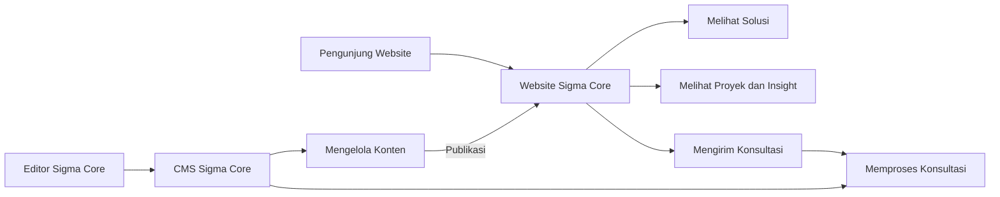
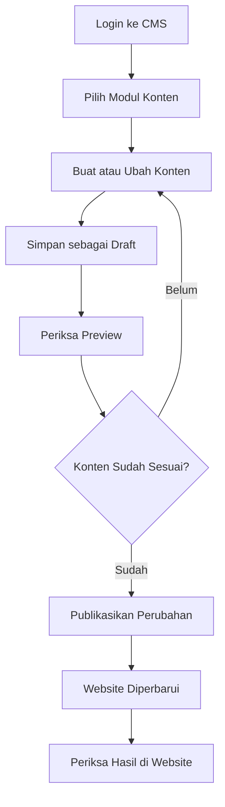
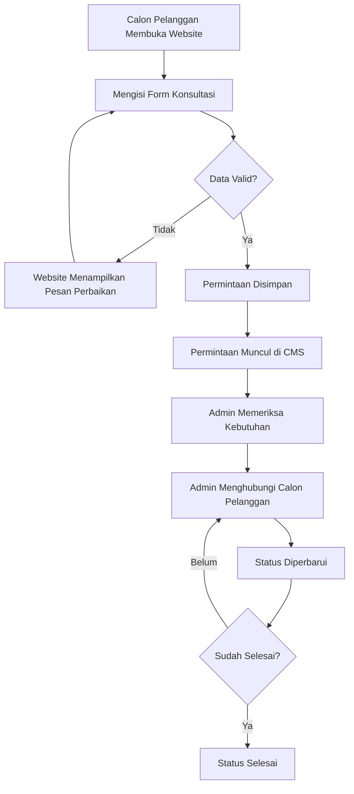
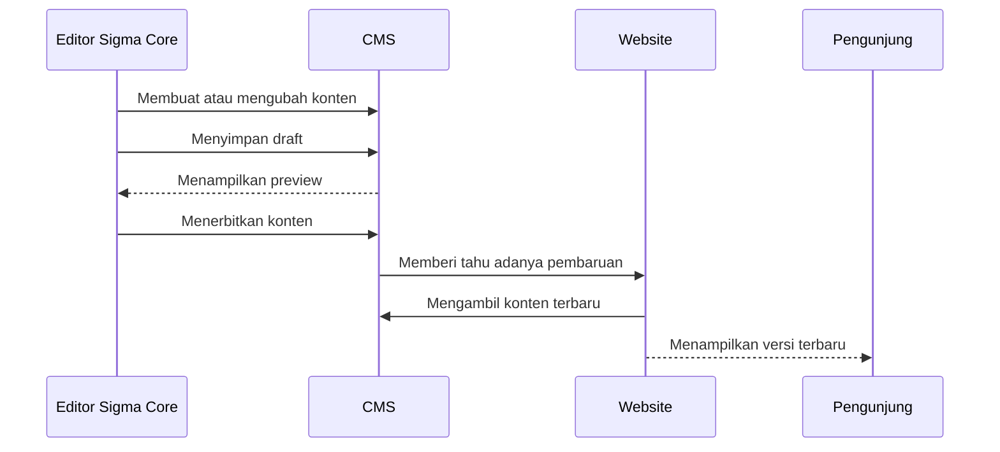

# Panduan Sistem Website dan CMS Sigma Core

**Dokumen untuk:** Manajemen, pemilik bisnis, administrator, dan pengelola konten PT Sigma Core Solusindo  
**Website:** https://sigmacore.id  
**CMS:** https://cms.sigmacore.id/admin  
**Status sistem:** Aktif di production

## 1. Tentang sistem

Website Company Profile Sigma Core merupakan media resmi perusahaan untuk memperkenalkan layanan, partner, proyek, insight, serta membuka jalur konsultasi bagi calon pelanggan.

Website dilengkapi dengan Content Management System atau CMS. Melalui CMS, tim Sigma Core dapat memperbarui konten tanpa mengubah source code dan tanpa selalu meminta bantuan developer.

Sistem dibagi menjadi tiga fungsi utama:

1. **Website publik** untuk pengunjung dan calon pelanggan.
2. **CMS** untuk mengelola serta menerbitkan konten.
3. **Sistem konsultasi** untuk menerima dan menindaklanjuti permintaan calon pelanggan.

## 2. Tujuan proyek

Proyek ini dikembangkan untuk:

- membangun identitas digital perusahaan yang profesional dan responsif;
- menjelaskan layanan Sigma Core secara terstruktur;
- menampilkan pengalaman perusahaan melalui partner dan proyek;
- menyediakan publikasi insight;
- memberikan kendali konten kepada tim internal;
- mengumpulkan permintaan konsultasi dari website;
- membantu admin memantau tindak lanjut calon pelanggan;
- memudahkan pengembangan fitur pada masa mendatang.

## 3. Gambaran sistem

Pengunjung hanya berinteraksi dengan website publik. Tim internal masuk ke CMS menggunakan akun masing-masing. Konten yang sudah dipublikasikan dari CMS akan tampil pada website.

## 4. Fitur yang tersedia

### Website publik

| Fitur | Manfaat bagi perusahaan dan pengunjung |
| --- | --- |
| Beranda | Menyampaikan profil dan nilai utama perusahaan |
| Solusi | Menjelaskan layanan dan kemampuan Sigma Core |
| Partner | Menampilkan perusahaan atau teknologi yang menjadi partner |
| Proyek | Menunjukkan pengalaman dan portofolio pekerjaan |
| Insight | Menyampaikan artikel, berita, atau wawasan perusahaan |
| Informasi kontak | Memudahkan pengunjung menghubungi perusahaan |
| WhatsApp | Menyediakan jalur komunikasi langsung |
| Form konsultasi | Mengumpulkan kebutuhan calon pelanggan secara terstruktur |
| Tampilan responsif | Memberikan pengalaman yang baik di desktop, tablet, dan ponsel |

### CMS

| Modul | Kegunaan |
| --- | --- |
| Dashboard | Ringkasan akses menuju pengelolaan konten |
| Pengguna | Mengelola akun dan kewenangan pengguna CMS |
| Solusi | Menambah dan memperbarui layanan perusahaan |
| Partner | Mengelola daftar serta logo partner |
| Proyek | Mengelola portofolio proyek |
| Insight | Menulis dan menerbitkan artikel |
| Konsultasi Masuk | Melihat dan memperbarui tindak lanjut konsultasi |
| Media | Menyimpan gambar dan file konten |
| Pengaturan Website | Mengelola identitas, kontak, SEO, footer, dan teks umum website |

## 5. Peran pengguna

### Administrator

Administrator memiliki kewenangan untuk:

- mengelola seluruh konten;
- membuka inbox konsultasi;
- memperbarui status konsultasi;
- mengelola akun pengguna;
- mengubah pengaturan utama website;
- menerbitkan perubahan.

### Editor

Editor berfokus pada pekerjaan konten, seperti:

- membuat dan memperbarui materi website;
- memilih gambar dari pustaka media;
- menyimpan draft;
- memeriksa preview;
- menerbitkan konten sesuai kewenangan yang diberikan.

Setiap pengguna sebaiknya memakai akun pribadi agar akses dan perubahan dapat dikelola dengan baik.

## 6. Alur pengelolaan konten

### Langkah penggunaan

1. Buka `https://cms.sigmacore.id/admin`.
2. Masuk menggunakan akun CMS.
3. Pilih modul yang ingin diperbarui.
4. Pilih data lama atau buat data baru.
5. Isi informasi dan media yang diperlukan.
6. Simpan sebagai draft.
7. Gunakan preview untuk memeriksa hasil.
8. Publikasikan setelah konten disetujui.
9. Periksa hasil pada website publik.

Perubahan yang masih berstatus draft tidak terlihat oleh pengunjung umum.

## 7. Alur konsultasi calon pelanggan

### Informasi yang diterima

Formulir konsultasi dapat memuat:

- nama calon pelanggan;
- nama perusahaan;
- alamat email;
- nomor telepon;
- solusi yang diminati;
- pilihan cara untuk dihubungi;
- penjelasan kebutuhan;
- halaman asal dan informasi kampanye bila tersedia.

### Status konsultasi

| Status | Arti dan tindakan yang disarankan |
| --- | --- |
| Baru | Permintaan baru diterima dan belum ditangani |
| Diproses | Permintaan sedang dipelajari atau ditugaskan |
| Sudah dihubungi | Tim sudah menghubungi calon pelanggan |
| Selesai | Tindak lanjut telah diselesaikan |

Admin disarankan memperbarui status segera setelah melakukan tindak lanjut agar kondisi pada dashboard tetap akurat.

## 8. Alur informasi antarsistem

Website dan CMS berjalan sebagai aplikasi terpisah. Pemisahan ini membuat pengelolaan konten lebih aman dan memungkinkan pembaruan salah satu aplikasi dilakukan secara terkontrol.

## 9. Teknologi yang digunakan

Bagian ini memberikan gambaran teknologi untuk kebutuhan pencatatan aset digital klien.

| Teknologi | Digunakan untuk | Manfaat |
| --- | --- | --- |
| Next.js | Website dan fondasi antarmuka CMS | Cepat, mendukung SEO, dan dapat dikembangkan lebih lanjut |
| React | Komponen tampilan | Antarmuka konsisten dan responsif |
| TypeScript | Source code aplikasi | Mengurangi kesalahan saat pengembangan |
| Payload CMS | Pengelolaan konten | CMS fleksibel dengan draft, preview, publikasi, dan akun pengguna |
| PostgreSQL | Penyimpanan data production | Database stabil untuk konten dan operasional |
| SQLite | Database development lokal | Memudahkan pengembangan dan pengujian |
| REST API | Komunikasi website, CMS, dan Core API | Pertukaran data antarsistem yang terstruktur |
| Docker | Menjalankan aplikasi di server | Deployment konsisten dan lebih mudah dipulihkan |
| Nginx | Akses domain dan HTTPS | Mengatur lalu lintas menuju website dan CMS |
| Node.js | Runtime aplikasi | Menjalankan website dan CMS di server |

Stack dipilih untuk mendukung website modern, pengelolaan konten mandiri, keamanan data, serta pengembangan berkelanjutan.

## 10. Konsep desain

Website menggunakan desain company profile modern dengan fokus pada keterbacaan, hierarki informasi, dan kemudahan navigasi. Tema visual menerapkan identitas Sigma Core dengan warna, tipografi, ruang, dan elemen interaksi yang konsisten.

CMS memakai tema yang selaras dengan identitas website, tetapi tampilannya disusun untuk kebutuhan kerja admin. Sidebar dapat ditampilkan penuh atau diperkecil menjadi panel ikon agar ruang kerja lebih luas tanpa menghilangkan navigasi.

Prinsip desain yang diterapkan:

- konsisten dengan identitas perusahaan;
- responsif pada berbagai ukuran layar;
- menu dan tindakan utama mudah ditemukan;
- status konsultasi mudah dibedakan;
- konten panjang tetap nyaman dibaca;
- form memberikan pesan yang jelas ketika data belum valid.

## 11. Pengelolaan media

Gunakan pustaka **Media** untuk gambar yang akan dipakai pada website.

Rekomendasi penggunaan:

- gunakan format WebP, JPEG, atau PNG sesuai kebutuhan;
- kompres gambar sebelum upload;
- gunakan nama file yang menggambarkan isi;
- hindari mengunggah file yang sama berulang kali;
- gunakan gambar dengan kualitas baik dan hak penggunaan yang jelas;
- periksa tampilan desktop dan ponsel sebelum publish.

Menghapus media yang masih digunakan oleh konten dapat menyebabkan gambar tidak tampil. Periksa relasi penggunaannya terlebih dahulu.

## 12. Standar pengelolaan konten

Sebelum konten diterbitkan, pastikan:

- judul singkat dan mudah dipahami;
- nama perusahaan, produk, dan partner ditulis konsisten;
- ejaan dan tanda baca telah diperiksa;
- tautan mengarah ke halaman yang benar;
- alamat email dan nomor telepon masih aktif;
- gambar tidak pecah dan sesuai konteks;
- slug tidak diubah tanpa kebutuhan yang jelas;
- preview sudah diperiksa;
- perubahan telah mendapatkan persetujuan pihak terkait.

## 13. Keamanan penggunaan

- Jangan membagikan kata sandi CMS kepada pengguna lain.
- Gunakan akun terpisah untuk setiap pengguna.
- Gunakan kata sandi yang kuat dan unik.
- Logout setelah memakai komputer bersama.
- Jangan memasukkan data rahasia ke konten publik.
- Laporkan aktivitas akun yang tidak dikenal kepada administrator.
- Simpan akses server dan database hanya untuk personel teknis yang berwenang.

Website tidak memberikan akses database langsung kepada pengunjung. Form konsultasi melewati validasi server sebelum disimpan.

## 14. Operasional dan pemeliharaan

### Tanggung jawab tim klien

- menjaga ketepatan dan legalitas konten;
- mengelola akun pengguna;
- menindaklanjuti konsultasi;
- menyetujui materi sebelum publish;
- melaporkan masalah dengan informasi yang cukup.

### Tanggung jawab tim teknis

- menjaga aplikasi dan dependency sesuai kebutuhan;
- melakukan backup sebelum perubahan penting;
- menangani perubahan source code dan database;
- memantau health service setelah deployment;
- membantu pemulihan bila terjadi gangguan;
- mendokumentasikan perubahan besar.

### Pemeriksaan berkala yang disarankan

| Frekuensi | Pemeriksaan |
| --- | --- |
| Harian | Konsultasi baru dan fungsi halaman utama |
| Mingguan | Link, media, akun aktif, dan konten terbaru |
| Bulanan | Backup, kapasitas server, log error, dan pembaruan keamanan |
| Sebelum deployment | Backup database/media dan pengujian perubahan |
| Setelah deployment | Website, CMS, publish, media, dan formulir konsultasi |

## 15. Pelaporan masalah

Saat melaporkan kendala, sertakan:

1. alamat halaman yang bermasalah;
2. waktu kejadian;
3. akun atau peran pengguna bila berkaitan dengan CMS;
4. langkah yang dilakukan sebelum masalah muncul;
5. pesan error yang terlihat;
6. screenshot bila membantu;
7. jenis perangkat dan browser.

Jangan mengirim kata sandi, secret, atau akses database melalui laporan biasa.

## 16. Pemeriksaan penerimaan sistem

Checklist ini dapat dipakai klien saat serah terima atau setelah deployment:

- [ ] Website dapat dibuka melalui domain resmi.
- [ ] Tampilan desktop dan ponsel dapat digunakan dengan baik.
- [ ] Menu utama mengarah ke halaman yang benar.
- [ ] Solusi, partner, proyek, dan insight tampil sesuai CMS.
- [ ] Admin dapat login ke CMS.
- [ ] Sidebar CMS dapat dibuka dan diperkecil.
- [ ] Konten dapat disimpan sebagai draft.
- [ ] Preview menampilkan perubahan draft.
- [ ] Publish memperbarui website.
- [ ] Media dapat diunggah dan tampil pada website.
- [ ] Form konsultasi berhasil dikirim.
- [ ] Data konsultasi muncul di CMS.
- [ ] Status konsultasi dapat diperbarui.
- [ ] Informasi kontak dan WhatsApp sudah benar.

## 17. Batas ruang lingkup

Sistem saat ini mencakup website company profile, CMS, pengelolaan media, workflow publikasi, dan penerimaan konsultasi. Hal berikut perlu dibahas sebagai pengembangan atau layanan terpisah bila dibutuhkan:

- penambahan modul bisnis baru;
- integrasi CRM atau aplikasi pihak ketiga;
- pembayaran online atau transaksi;
- portal pelanggan;
- aplikasi mobile;
- perubahan desain besar;
- produksi konten dan fotografi;
- domain, server, email, dan layanan pihak ketiga;
- pemeliharaan berkelanjutan di luar kesepakatan proyek.

## 18. Ringkasan hasil proyek

Sigma Core telah memiliki website company profile yang terhubung dengan CMS dan sistem konsultasi. Tim internal dapat mengelola konten, memeriksa draft, menerbitkan perubahan, serta memantau permintaan konsultasi melalui dashboard yang sama.

Arsitektur aplikasi dibuat terpisah antara website publik dan CMS agar pengelolaan, keamanan, deployment, dan pengembangan berikutnya dapat dilakukan secara lebih terkontrol.

Dokumen teknis untuk developer dan administrator tersedia pada `docs/PROJECT-DOCUMENTATION.md`.
