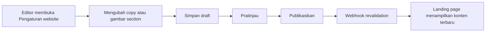

# Audit Integrasi Konten Landing Page dan CMS

**Tanggal audit:** 19 September 2026  
**Cakupan:** website publik dan Payload CMS Sigma Core

## Hasil audit

Data utama Solusi, Partner, Proyek, Insight, kontak, SEO, tentang perusahaan, cara kerja, keunggulan, dan konsultasi sebelumnya sudah berasal dari CMS. Audit menemukan sejumlah copy pemasaran, label navigasi, gambar section, dan call-to-action yang masih tertanam pada komponen landing page.

Seluruh temuan konten pemasaran beranda berikut sudah dipindahkan ke global **Pengaturan website** di CMS:

| Area | Konten yang sekarang dapat diedit |
| --- | --- |
| Header | Label menu, tombol konsultasi, dan copy mega menu Solusi |
| Hero | Gambar, alt text, dua tombol, dan empat nilai utama |
| Solusi | Eyebrow, judul, deskripsi, label link kartu, serta empty state |
| Cara kerja | Gambar, alt text, dan badge gambar, selain copy dan tahapan yang sudah tersedia |
| Proyek pilihan | Eyebrow, judul, deskripsi, link arsip, dan label klien rahasia |
| Ekosistem partner | Eyebrow, judul, dan deskripsi |
| Insight terbaru | Eyebrow, judul, deskripsi, dan link arsip |
| Form konsultasi | Label tombol, teks privasi, dan pilihan tanpa solusi |
| WhatsApp | Label kecil, label tombol, dan pesan pembuka |
| Footer | Tagline, CTA, judul kolom, kembali ke atas, dan copyright |

Isi setiap kartu atau record tetap dikelola pada menu khususnya:

- **Solusi:** judul, slug, ringkasan, fitur, ikon, manfaat, use case, detail, gambar, dan partner terkait.
- **Partner:** nama, logo, website, urutan, dan status tayang.
- **Proyek:** judul, industri, klien, ringkasan, detail case study, teknologi, cover, dan relasi solusi.
- **Insight:** judul, kategori, tanggal, ringkasan, artikel, cover, SEO, dan relasi solusi.

## Alur setelah perubahan

## Konten yang tetap berada di source code

Elemen berikut sengaja tidak dijadikan konten CMS karena merupakan bagian dari perilaku aplikasi, keamanan, atau aksesibilitas:

- pesan error validasi dan kegagalan jaringan;
- nama field formulir seperti Nama, Email, dan Nomor telepon;
- breadcrumb serta label struktur halaman detail;
- URL internal dan ID anchor section;
- label aksesibilitas yang menjelaskan fungsi kontrol;
- format tanggal dan status proses sistem;
- pesan preview draft dan halaman tidak ditemukan.

Perubahan pada elemen tersebut harus melalui review developer agar tidak merusak validasi, navigasi, SEO, atau aksesibilitas.

## Kompatibilitas dan migrasi

- Landing page memiliki fallback untuk field baru sehingga tetap dapat berjalan saat CMS lama belum diperbarui.
- Migration SQLite dan PostgreSQL mengisi copy lama sebagai nilai default; konten yang sudah ada tidak ditimpa.
- Gambar hero dan cara kerja tetap memakai aset bawaan jika editor belum memilih media CMS.
- Export/import content bundle sudah diperbarui agar field baru dan relasi media ikut dimigrasikan.
- Publish dari global Pengaturan website tetap memicu revalidation landing page.

## Validasi

- Landing page: 19 test lulus, typecheck lulus, production build lulus.
- CMS: 28 test lulus, generated Payload types berhasil, typecheck lulus, production build lulus.
- Migration SQLite: seluruh migration berhasil dijalankan dari database kosong.

Sebelum deployment production, buat backup PostgreSQL dan volume media lalu jalankan migration CMS sebelum mengganti image landing page.
