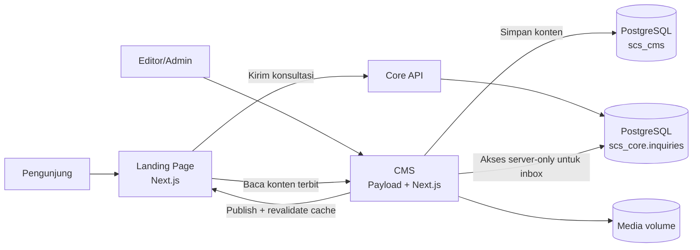

# Dokumentasi Website Company Profile dan CMS Sigma Core

**Nama sistem:** Sigma Core Company Profile  
**Dokumen untuk:** PT Sigma Core Solusindo, pengelola konten, developer, dan administrator server  
**Status:** Berjalan di production  
**Website:** https://sigmacore.id  
**CMS:** https://cms.sigmacore.id/admin

## 1. Gambaran umum

Sistem ini terdiri dari dua aplikasi yang dapat dikembangkan dan dirilis secara terpisah:

1. **Landing page / public website** menampilkan informasi perusahaan kepada pengunjung.
2. **Content Management System (CMS)** digunakan tim internal untuk mengelola konten dan permintaan konsultasi tanpa mengubah source code.

Konten yang sudah diterbitkan di CMS akan dibaca oleh landing page melalui REST API. Website publik tidak memiliki akses langsung ke database CMS. Pemisahan ini menjaga kredensial database tetap berada di sisi server dan membuat pengembangan masing-masing aplikasi lebih aman serta mudah dirawat.



## 2. Ruang lingkup fitur

### Landing page

- Beranda company profile dengan tampilan responsif.
- Navigasi, identitas perusahaan, hero, daftar solusi, partner, proyek, insight, kontak, dan footer.
- Halaman detail solusi berdasarkan slug: `/solusi/[slug]`.
- Daftar dan detail proyek: `/proyek` dan `/proyek/[slug]`.
- Daftar dan detail insight: `/insight` dan `/insight/[slug]`.
- Tombol WhatsApp dan informasi kontak perusahaan.
- Formulir konsultasi yang tervalidasi dan terhubung ke Core API.
- Metadata dan sitemap untuk mendukung SEO.
- Preview draft dari CMS sebelum konten diterbitkan.
- Pembaruan cache otomatis setelah editor menerbitkan konten.

### CMS

- Login dan autentikasi pengguna.
- Dashboard admin dengan navigasi responsif.
- Sidebar yang dapat diperkecil menjadi panel ikon dan dikembalikan ke tampilan lengkap.
- Hak akses berdasarkan peran pengguna.
- Pengelolaan Solusi, Partner, Proyek, Insight, Media, dan Pengaturan Website.
- Editor rich text berbasis Lexical.
- Alur draft, preview, publish, versi, dan waktu publikasi.
- Inbox **Konsultasi Masuk** dengan pencarian dan filter status.
- Status konsultasi: Baru, Diproses, Sudah dihubungi, dan Selesai.
- Catatan pembaruan status untuk kebutuhan audit operasional.
- Ekspor dan impor paket konten.
- Dukungan SQLite untuk development dan PostgreSQL untuk production.

## 3. Teknologi yang digunakan

| Area | Teknologi | Fungsi |
| --- | --- | --- |
| Bahasa | TypeScript | Source code dengan pemeriksaan tipe |
| Frontend | React 19 | Komponen antarmuka |
| Framework | Next.js 16 App Router | Routing, server rendering, API route, cache, dan optimasi gambar |
| Styling | CSS dan Tailwind CSS 4 toolchain | Layout, tema, responsive design, dan komponen visual |
| Ikon | Lucide React | Ikon website dan dashboard |
| CMS | Payload CMS 3 | Admin panel, REST API, autentikasi, workflow konten, dan media |
| Rich text | Lexical | Editor konten terstruktur |
| Database CMS | PostgreSQL 17 | Data production CMS |
| Database lokal | SQLite | Development ringan tanpa server database terpisah |
| Pengolahan gambar | Sharp | Resize dan optimasi media di CMS |
| Email | Nodemailer/SMTP | Dukungan pengiriman email dari CMS bila dikonfigurasi |
| Package manager | pnpm 10 | Instalasi dependency dan script project |
| Runtime | Node.js 22 | Menjalankan dan membangun kedua aplikasi |
| Container | Docker dan Docker Compose | Build, isolasi, health check, dan deployment |
| Reverse proxy | Nginx 1.28 Alpine | Routing domain, HTTPS, dan proxy ke aplikasi |

Versi lengkap dependency dikunci dalam `package.json` dan `pnpm-lock.yaml` pada masing-masing repository.

## 4. Konsep pengembangan

### Dua repository, satu sistem

Landing page dan CMS berada di repository terpisah. Keduanya berkomunikasi menggunakan HTTP API dan shared secret. Keuntungannya:

- Deployment CMS tidak selalu mengharuskan deployment landing page.
- Website publik tidak terhubung langsung ke PostgreSQL.
- Gangguan pada Core API konsultasi tidak menghentikan editor mengelola konten CMS.
- Tim dapat melakukan rollback per aplikasi.

### Server-first rendering

Landing page membaca konten CMS dari server Next.js. Browser menerima halaman yang sudah dirender, sehingga kredensial internal tidak dikirim ke pengunjung dan konten dapat diindeks mesin pencari.

### CMS sebagai sumber konten utama

Saat `CMS_API_URL` terisi, data terbit dari CMS menjadi sumber utama untuk website. Konten bawaan di repository hanya dipakai untuk pengembangan antarmuka mandiri ketika koneksi CMS sengaja tidak dikonfigurasi.

### Draft, preview, dan publish

Editor dapat menyimpan draft tanpa mengubah website publik. Tombol preview membuka halaman landing melalui URL bertanda tangan dan mengaktifkan Next.js Draft Mode. Saat konten dipublikasikan, CMS memanggil endpoint revalidation website; cache konten dan halaman terkait kemudian diperbarui.

### Responsive design

Komponen dibuat agar beradaptasi pada desktop, tablet, dan perangkat seluler. CMS menggunakan sidebar penuh pada ruang yang cukup dan panel ikon saat diperkecil. Status aktif, label, dan akses navigasi tetap tersedia pada kedua kondisi.

### Keamanan pada formulir konsultasi

Formulir tidak mengirim data langsung dari browser ke database. Endpoint internal landing page melakukan:

- validasi tipe, format email, nomor telepon, panjang teks, dan pilihan kontak;
- pemeriksaan origin untuk menolak permintaan lintas situs;
- pembatasan ukuran request;
- honeypot untuk bot;
- rate limit lima percobaan per 15 menit per alamat klien pada satu instance;
- timeout saat menghubungi Core API.

## 5. Struktur source code

### Repository landing page

Nama repository: `landing-page-projects-sigma-core`

```text
landing-page-projects-sigma-core/
├── src/
│   ├── app/                    # Route dan layout Next.js App Router
│   │   ├── api/
│   │   │   ├── inquiries/     # Proxy dan validasi formulir konsultasi
│   │   │   ├── preview/       # Aktivasi preview draft CMS
│   │   │   └── revalidate/    # Invalidasi cache setelah publish
│   │   ├── insight/            # Daftar dan detail insight
│   │   ├── proyek/             # Daftar dan detail proyek
│   │   ├── solusi/[slug]/      # Detail solusi
│   │   ├── layout.tsx          # Layout global
│   │   ├── page.tsx            # Beranda
│   │   └── globals.css         # Tema dan style global
│   ├── components/             # Komponen UI yang dapat digunakan ulang
│   ├── content/site.ts         # Konten fallback untuk UI development
│   └── lib/                    # Adapter CMS, mapping data, dan validasi
├── public/                      # Aset statis
├── docs/                        # Dokumentasi teknis
├── infra/nginx/                 # Konfigurasi reverse proxy
├── scripts/                     # Test dan utilitas project
├── Dockerfile                   # Image production website
├── compose.prod.yaml            # Service website dan proxy
└── package.json                 # Dependency dan perintah pnpm
```

File utama:

- `src/lib/cms-content.ts`: mengambil snapshot konten published atau draft dari Payload.
- `src/lib/cms-solutions.ts`: validasi base URL dan pemetaan data solusi.
- `src/lib/landing-content.ts`: mengubah respons CMS menjadi model tampilan landing page.
- `src/lib/inquiry.ts`: tipe data dan validasi konsultasi.
- `src/app/api/inquiries/route.ts`: meneruskan konsultasi yang valid ke Core API.
- `src/app/api/revalidate/route.ts`: membersihkan cache berdasarkan koleksi yang berubah.
- `src/components/ContactForm.tsx`: UI dan state formulir konsultasi.

### Repository CMS

Nama repository: `scs-company-profile-cms`

```text
scs-company-profile-cms/
├── app/(payload)/
│   ├── admin/                   # Admin UI Payload
│   └── api/                     # REST API, health, preview, konsultasi
├── cms/
│   ├── collections/             # Users, Media, Solutions, Partners,
│   │                            # Projects, dan Insights
│   ├── globals/                 # Site Settings
│   ├── components/              # Dashboard, sidebar, login, konsultasi
│   ├── migrations/              # Migrasi SQLite dan PostgreSQL
│   └── content-workflow.ts      # Draft/publish dan webhook revalidation
├── scripts/                     # Admin, import/export, migrasi konsultasi
├── tests/                       # Pengujian CMS dan integrasi
├── public/media/                # Media lokal; volume persisten di production
├── payload.config.ts            # Konfigurasi utama Payload
├── payload-types.ts             # Tipe yang dihasilkan Payload
├── Dockerfile                   # Image production CMS
└── compose.prod.yaml            # Service dan volume CMS
```

## 6. Model konten CMS

| Modul | Kegunaan utama |
| --- | --- |
| Users | Akun admin/editor dan peran akses |
| Media | Gambar dan file yang digunakan konten |
| Solutions | Daftar layanan serta halaman detail solusi |
| Partners | Logo dan informasi partner |
| Projects | Portofolio serta halaman detail proyek |
| Insights | Artikel atau insight perusahaan |
| Site Settings | Identitas, navigasi, kontak, SEO, footer, dan teks konsultasi |

Koleksi konten mendukung urutan tampilan, status publikasi, draft, dan versi. Relasi media dikelola oleh Payload agar editor memilih aset melalui pustaka media.

## 7. Alur data utama

### Menampilkan konten

1. Pengunjung membuka halaman website.
2. Next.js meminta data published ke REST API CMS melalui `CMS_API_URL`.
3. CMS membaca data dari PostgreSQL dan mengembalikan JSON.
4. Next.js memetakan data, merender halaman, dan menyimpan cache maksimal lima menit.
5. Gambar ditampilkan dari endpoint media CMS dan dioptimasi oleh Next.js.

### Menerbitkan perubahan

1. Editor mengubah konten dan menyimpan draft.
2. Editor memeriksa hasil melalui preview bila diperlukan.
3. Editor memilih **Publikasikan perubahan**.
4. CMS menyimpan versi published lalu mengirim webhook bertanda tangan ke website.
5. Website memvalidasi secret, membersihkan tag cache, route terkait, dan sitemap.
6. Pengunjung menerima konten baru pada request berikutnya.

### Mengirim dan memproses konsultasi

1. Pengunjung mengisi formulir pada landing page.
2. Endpoint `/api/inquiries` memvalidasi request.
3. Data valid diteruskan server-to-server ke `/api/v1/inquiries` pada Core API.
4. Core API menyimpan data di `scs_core.inquiries` dan mengembalikan nomor referensi.
5. Admin membuka **Konsultasi Masuk** di CMS; server CMS membaca database Core melalui koneksi server-only untuk mencari, memfilter, dan memperbarui status.
6. Perubahan status beserta pengguna dan waktunya disimpan sebagai riwayat audit.

## 8. Menjalankan project secara lokal

### Prasyarat

- Node.js 22
- pnpm 10.17.1
- Git
- Core API lokal bila ingin menguji pengiriman konsultasi secara penuh

### CMS

Jalankan CMS lebih dahulu:

```powershell
cd D:\Projects-Data\Projects\scs-company-profile-cms
Copy-Item .env.example .env.local
pnpm install
pnpm dev -- --port 3101
```

CMS tersedia di `http://localhost:3101/admin`. Konfigurasi default development menggunakan SQLite pada `.data/payload.db`.

### Landing page

Pada terminal lain:

```powershell
cd D:\Projects-Data\Projects\landing-page-projects-sigma-core
Copy-Item .env.example .env.local
pnpm install
pnpm dev -- --port 3001
```

Landing page tersedia di `http://localhost:3001`. Untuk memakai CMS lokal, pastikan `.env.local` memuat:

```dotenv
NEXT_PUBLIC_SERVER_URL=http://localhost:3001
CMS_API_URL=http://localhost:3101/api
CMS_ADMIN_URL=http://localhost:3101/admin
CORE_API_URL=http://localhost:8080
```

Nilai secret preview dan revalidation harus berpasangan:

| Landing page | CMS |
| --- | --- |
| `CMS_PREVIEW_SECRET` | `WEBSITE_PREVIEW_SECRET` |
| `CMS_REVALIDATE_SECRET` | `WEBSITE_REVALIDATE_SECRET` |

Jangan menyimpan secret asli di Git.

## 9. Perintah pengembangan

Pada masing-masing repository:

```powershell
pnpm dev
pnpm typecheck
pnpm test
pnpm build
pnpm start
```

Perintah khusus CMS:

```powershell
pnpm cms:create-admin
pnpm cms:types
pnpm cms:importmap
pnpm content:export
pnpm content:import
pnpm core-inquiries:migrate
```

Lakukan `typecheck`, `test`, dan `build` sebelum perubahan dikirim atau dirilis.

## 10. Environment production

### Landing page

| Variable | Keterangan |
| --- | --- |
| `NEXT_PUBLIC_SERVER_URL` | Origin canonical website |
| `CMS_API_URL` | Base REST API Payload, termasuk `/api` |
| `CMS_ADMIN_URL` | URL admin untuk kembali dari preview |
| `CMS_PREVIEW_SECRET` | Secret preview draft |
| `CMS_REVALIDATE_SECRET` | Secret webhook cache |
| `CORE_API_URL` | Origin internal Core API |

### CMS

| Variable | Keterangan |
| --- | --- |
| `PAYLOAD_SECRET` | Secret utama autentikasi Payload |
| `PAYLOAD_SERVER_URL` | Origin CMS |
| `WEBSITE_URL` | Origin website yang diizinkan |
| `PAYLOAD_DB_PROVIDER` | Gunakan `postgres` di production |
| `DATABASE_URL` | Koneksi PostgreSQL CMS |
| `CORE_DATABASE_URL` | Koneksi server-only untuk inbox konsultasi |
| `WEBSITE_PREVIEW_SECRET` | Pasangan secret preview website |
| `WEBSITE_REVALIDATE_SECRET` | Pasangan secret revalidation website |
| `SMTP_*` | Konfigurasi email opsional |

Gunakan `.env.production.example` sebagai daftar kontrak terbaru. File `.env.production` dan seluruh secret tidak boleh masuk repository.

## 11. Arsitektur production

Lokasi aplikasi pada server:

```text
/opt/scs-company-profile/source                    # landing page
/opt/scs-company-profile/scs-company-profile-cms  # CMS
```

Container utama:

| Container | Fungsi |
| --- | --- |
| `scs-web-web-1` | Landing page Next.js |
| `scs-company-profile-cms-cms-1` | Payload CMS |
| `scs-company-profile-proxy-1` | Nginx reverse proxy |
| `scs-company-profile-core-api-1` | API konsultasi |
| `scs-company-profile-postgres-1` | PostgreSQL |

Media CMS berada pada Docker volume persisten yang dipasang ke `/app/public/media`. Data PostgreSQL juga berada pada volume persisten. Mengganti image aplikasi tidak menghapus kedua data tersebut.

## 12. Prosedur deployment ringkas

1. Pastikan perubahan sudah berada pada branch yang disepakati dan server dapat mengambil commit tersebut.
2. Buat backup database PostgreSQL dan volume media CMS.
3. Deploy CMS terlebih dahulu bila ada perubahan schema atau kontrak API.
4. Jalankan migrasi database yang disediakan repository CMS.
5. Build dan hidupkan ulang container CMS.
6. Pastikan endpoint `/api/health` mengembalikan HTTP 200.
7. Build dan hidupkan ulang container landing page.
8. Pastikan website mengembalikan HTTP 200 dan container berstatus healthy.
9. Publikasikan satu perubahan aman dari CMS dan pastikan tampil di landing page.
10. Kirim satu konsultasi uji, pastikan muncul di dashboard, lalu uji pembaruan status.

Deployment harus memakai image yang diberi tag commit atau versi agar rollback dapat ditelusuri. Jangan menghapus volume database atau media saat memperbarui aplikasi.

## 13. Backup dan pemulihan

Sebelum deployment yang mengubah schema atau media, simpan:

- dump database `scs_cms`;
- dump database atau schema konsultasi Core API bila terdampak;
- arsip Docker volume media;
- commit dan tag image yang sedang berjalan;
- salinan file konfigurasi production yang diperlukan, tanpa memasukkannya ke Git.

Pemulihan dilakukan dengan mengembalikan image versi sebelumnya dan, bila migrasi menyebabkan incompatibility data, mengembalikan database serta media dari backup yang berasal dari waktu yang sama.

## 14. Pemeriksaan setelah deployment

Checklist minimum:

- [ ] `https://sigmacore.id` merespons HTTP 200.
- [ ] `https://cms.sigmacore.id/api/health` merespons HTTP 200.
- [ ] Login CMS berhasil.
- [ ] Gambar dan media tampil pada CMS dan website.
- [ ] Halaman beranda, solusi, proyek, dan insight dapat dibuka.
- [ ] Draft preview dapat dibuka oleh editor.
- [ ] Publish dari CMS memperbarui website.
- [ ] Form konsultasi menghasilkan nomor referensi.
- [ ] Konsultasi baru muncul pada inbox CMS.
- [ ] Admin dapat memperbarui status konsultasi.
- [ ] Seluruh container terkait berstatus `healthy`.

## 15. Panduan penggunaan untuk klien

### Memperbarui konten

1. Masuk ke CMS.
2. Pilih modul pada sidebar, misalnya **Solusi**, **Proyek**, atau **Pengaturan website**.
3. Pilih data yang akan diubah atau buat data baru.
4. Isi field wajib dan pilih media bila diperlukan.
5. Simpan sebagai draft untuk melanjutkan nanti.
6. Gunakan preview untuk memeriksa tampilan.
7. Pilih **Publikasikan perubahan** setelah konten disetujui.

### Menangani konsultasi

1. Buka menu **Konsultasi Masuk**.
2. Gunakan pencarian atau filter status.
3. Baca identitas, kebutuhan, solusi yang diminati, dan pilihan kontak pengirim.
4. Hubungi calon klien melalui kanal yang dipilih.
5. Ubah status sesuai tindak lanjut dan simpan.

### Praktik editorial

- Gunakan judul yang ringkas dan konsisten.
- Optimalkan ukuran gambar sebelum upload.
- Periksa nomor telepon, email, tautan, dan ejaan sebelum publish.
- Gunakan draft dan preview untuk perubahan besar.
- Jangan membagikan akun CMS; buat akun pengguna terpisah sesuai peran.

## 16. Pembagian tanggung jawab

| Peran | Tanggung jawab |
| --- | --- |
| Klien/editor | Menyiapkan, memeriksa, dan menerbitkan konten |
| Admin CMS | Mengelola pengguna dan konsultasi |
| Developer | Mengembangkan fitur, migrasi, integrasi, dan pengujian |
| Administrator server | Backup, environment, container, SSL, monitoring, dan rollback |

## 17. Batasan dan catatan operasional

- Cache published landing page memiliki masa maksimum lima menit, tetapi publish normal memicu pembaruan segera melalui webhook.
- Rate limit formulir disimpan dalam memori instance website. Bila sistem kemudian memakai banyak replica, rate limit terdistribusi sebaiknya dipindahkan ke Redis atau gateway.
- CMS dan Core API harus dapat dijangkau melalui jaringan internal Docker agar konsultasi berfungsi.
- Media tetap dilayani dari origin CMS; domain tersebut harus dapat diakses browser.
- Perubahan struktur koleksi harus disertai migrasi database dan regenerasi `payload-types.ts`.
- Penambahan fitur, perubahan desain besar, domain, hosting, dan pemeliharaan berkelanjutan dikelola sebagai ruang lingkup terpisah sesuai kesepakatan proyek.

## 18. Referensi repository

- Landing page: `git@github.com:Wahayu26/landing-page-projects-sigma-core.git`
- CMS: `git@github.com:Wahayu26/scs-company-profile-cms.git`
- Integrasi teknis tambahan: `docs/CMS-INTEGRATION.md` pada repository landing page.
- Deployment CMS: `docs/DEPLOYMENT.md` pada repository CMS.
- Migrasi konten: `docs/CONTENT-MIGRATION.md` pada repository CMS.

Dokumen ini menjelaskan kondisi sistem pada saat implementasi dan deployment terakhir. Perbarui dokumentasi ketika ada perubahan arsitektur, dependency utama, kontrak environment, model konten, atau prosedur deployment.
